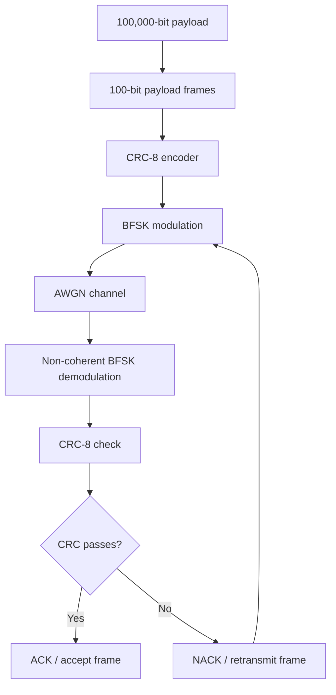
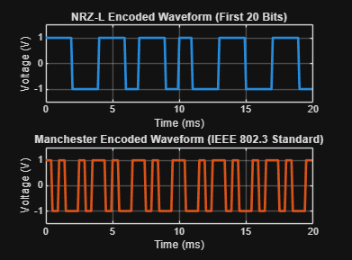
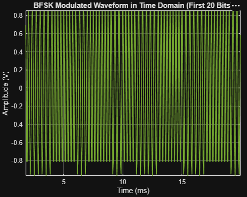
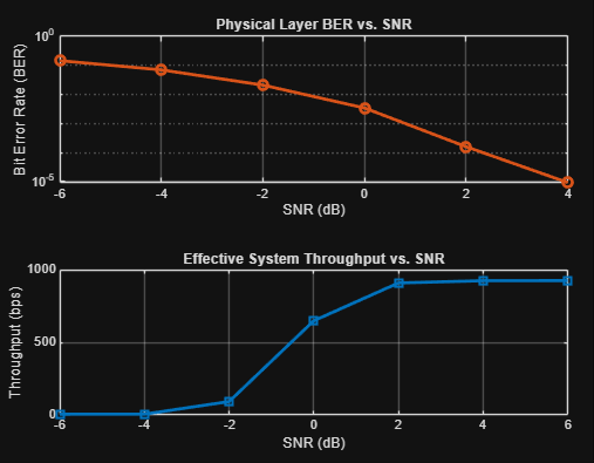
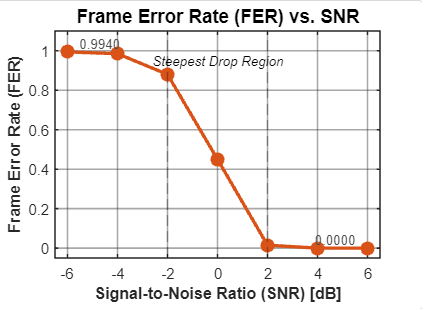
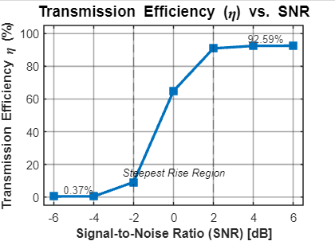

# Design and Simulation of a Reliable Digital Communication System Using BFSK Modulation

A MATLAB implementation of a digital communication link combining Binary Frequency-Shift Keying (BFSK), an Additive White Gaussian Noise (AWGN) channel, CRC-8 error detection, and Stop-and-Wait Automatic Repeat reQuest (ARQ).

The project was developed as a collaborative academic project for **DIGDACM (E35), De La Salle University**. The original report is dated August 22, 2026. The full course report is not included in this repository; only selected, de-identified figures from the report are provided.

## Features

- Generates a reproducible 100,000-bit pseudo-random payload.
- Encodes and plots NRZ-L and Manchester baseband waveforms.
- Modulates framed bits using BFSK: 3 kHz for binary 0 and 4 kHz for binary 1.
- Simulates a real-valued AWGN channel across an SNR sweep from -6 dB to +6 dB.
- Demodulates using non-coherent quadrature energy detection.
- Adds and verifies an 8-bit CRC using modulo-2 division and the polynomial `x^8 + x^2 + x + 1` (`0x07`).
- Uses Stop-and-Wait ARQ logic to retransmit frames that fail CRC validation.
- Reports BER, FER, retransmission count, effective throughput, and efficiency.

## System overview



See [`docs/system-architecture.md`](docs/system-architecture.md) for the full parameter list and an implementation detail about line coding.

## Requirements

- MATLAB with support for local `.m` functions and standard plotting functions.
- No Communications Toolbox is required.

The project is organized as a function-based entry point plus helper functions. A MATLAB release that supports the functions used in this repository is recommended.

## How to run

1. Download or clone this repository.
2. Open the repository folder in MATLAB.
3. Run the following command in the MATLAB Command Window:

   ```matlab
   results = run_simulation;
   ```

4. Generated plots and `simulation_metrics.csv` will be saved in `results/generated/`.

The default simulation uses the report's parameters and fixed random seed (`101`). The full 100,000-bit, seven-SNR sweep can take time, especially at low SNR because Stop-and-Wait ARQ may retransmit frames many times.

## Parameters

| Parameter | Value |
|---|---:|
| Payload length | 100,000 bits |
| Payload per frame | 100 bits |
| CRC length | 8 bits |
| Total frame length | 108 bits |
| Bit rate | 1,000 bits/s |
| Sampling frequency | 20,000 Hz |
| Samples per bit | 20 |
| Carrier frequency, bit 0 | 3,000 Hz |
| Carrier frequency, bit 1 | 4,000 Hz |
| SNR values | -6, -4, -2, 0, 2, 4, 6 dB |
| CRC generator polynomial | `x^8 + x^2 + x + 1` (`0x07`) |

## Reported results

The table below transcribes the output documented in the original report. Rerunning the code will create a fresh `simulation_metrics.csv`; exact output can depend on MATLAB version and execution details.

| SNR (dB) | BER | FER | Retransmissions | Throughput (bps) | Efficiency (%) |
|---:|---:|---:|---:|---:|---:|
| -6 | 0.14269 | 0.9940 | 251,070 | 3.7 | 0.37 |
| -4 | 0.06877 | 0.9970 | 233,795 | 3.9 | 0.39 |
| -2 | 0.02063 | 0.8880 | 9,168 | 91.1 | 9.11 |
| 0 | 0.00337 | 0.3100 | 427 | 648.9 | 64.89 |
| 2 | 0.00016 | 0.0170 | 18 | 909.6 | 90.96 |
| 4 | 0.00001 | 0.0010 | 1 | 925.0 | 92.50 |
| 6 | 0.00000 | 0.0000 | 0 | 925.9 | 92.59 |

The theoretical efficiency ceiling from 100 payload bits per 108-bit frame is approximately 92.59%, before accounting for retransmissions. The reported throughput approaches this ceiling at high SNR.

## Selected figures from the report

**NRZ-L and Manchester waveforms** (original report, page 18)



**BFSK modulated waveform** (original report, page 18)



**Physical-layer BER and effective throughput** (original report, page 21)



**Frame error rate** (original report, page 22)



**Transmission efficiency** (original report, page 22)



## Repository structure

```text
BFSK-Digital-Communication-System/
├── README.md
├── run_simulation.m
├── src/
│   ├── add_awgn_noise.m
│   ├── crc8_decode.m
│   ├── crc8_encode.m
│   ├── demodulate_bfsk.m
│   ├── encode_manchester.m
│   ├── encode_nrz_l.m
│   ├── modulate_bfsk.m
│   └── validate_binary_vector.m
├── docs/
│   ├── implementation-notes.md
│   ├── individual-contributions.md
│   └── system-architecture.md
└── results/
    ├── generated/          # Created when the MATLAB simulation runs
    └── report_figures/     # Selected figures extracted from the course report
```

## Team contributions

- **Xhane Paulei Batiller:** CRC-8 encoder/decoder and Stop-and-Wait ARQ implementation; conclusion and recommendations.
- **Zachary E. Lacsamana:** Binary data generation, AWGN channel, and performance analysis.
- **Eliseo Miguel F. Quinsaat IV:** NRZ-L/Manchester line coding, BFSK modulation/demodulation, and waveform analysis.

More detail is available in [`docs/individual-contributions.md`](docs/individual-contributions.md).

## Important implementation note

The report's MATLAB listing generates NRZ-L and Manchester waveforms for comparison, but the actual BFSK/CRC/ARQ transmission path modulates the CRC-framed bit sequence directly. The line-coded waveform is not fed into the BFSK modulator in the documented implementation. See [`docs/implementation-notes.md`](docs/implementation-notes.md).

## Attribution and sharing

This is a collaborative academic project. Please retain contributor acknowledgments and check that public release is permitted by the course and all project contributors. No open-source license is included because a group license decision has not been specified.
